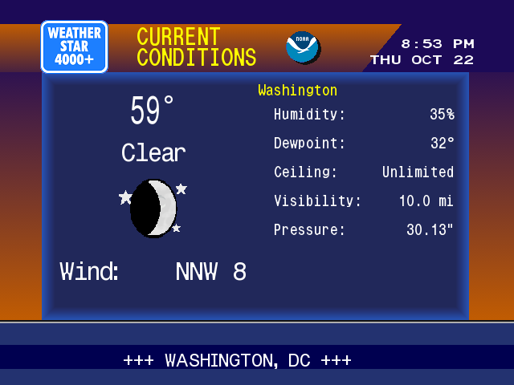
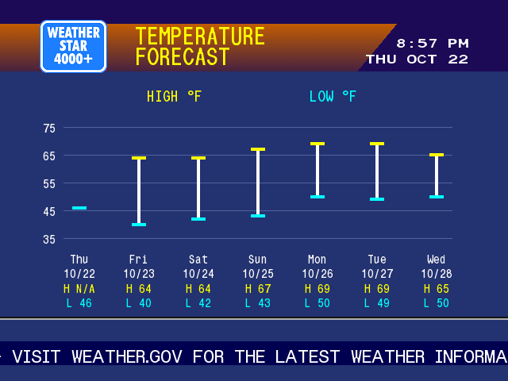
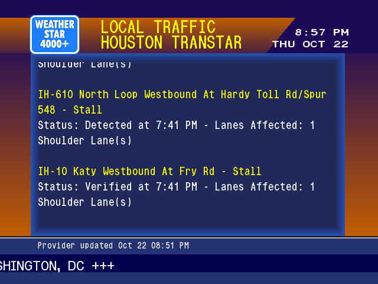
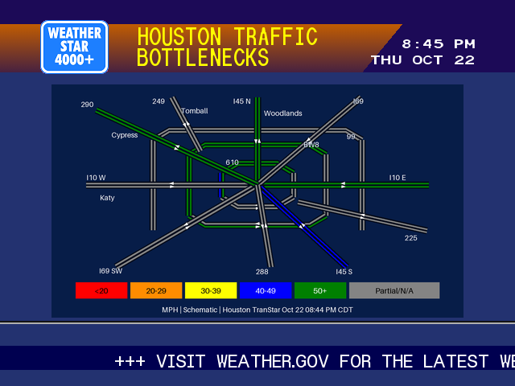

# WeatherStar 4000 Native

A retro weather channel for your own screen: animated weather icons, forecasts, radar, scrolling history and RSS headlines, delivered as a 640×480 HLS stream at 30 fps.

The collector keeps weather data ready. Rendering and encoding start when a viewer requests HLS and stop after 120 seconds without playback requests. Multiple viewers share one producer.

**Available now:** public AMD64 images are published to GHCR and anonymous pull has been verified. Optional graph, RSS and configured traffic-map pages are available. See [Benchmarks](docs/BENCHMARKS.md) for measured playback and resource limits.

## CPU and memory

**About 53% less CPU and 61% less RAM during playback** in our measured twelve-page comparison with the Python channel. With no viewers, the native service stops rendering and encoding while keeping data collection independent.

The October 22, 2026 comparison measured both containers concurrently on the same Linux AMD64 host for about five minutes per window. Both delivered the same twelve-page rotation at 640×480 and 30 fps with software H.264 encoding and separately supplied music. CPU percentages use **one core as 100%**; RAM is average container working set.

| State | Python CPU | Native CPU | Python RAM | Native RAM |
|---|---:|---:|---:|---:|
|No viewers, cold idle|43.77%|0.28%|202.95 MiB|14.38 MiB|
|Watching the channel|45.25%|21.46%|202.86 MiB|78.30 MiB|

The Python baseline was our modified headless channel derived from [WeatherStar 4000 Python](https://github.com/wesellis/weatherstar-4000), including display and performance repairs; these are **not measurements of an untouched upstream installation**. The native baseline was the twelve-page prototype, before the graph and traffic additions. Cold-idle RAM is not a promise of immediate memory reclamation after watching.

For the later configurable build, a separate five-minute **cached-playback** measurement with all sixteen pages—including the temperature graph, traffic RSS, Flow and Bottlenecks—averaged **18.87% of one CPU core and 82.41 MiB RAM**, with an **88.77 MiB peak working set**. The base twelve pages in that same experiment averaged 17.60% CPU and 72.10 MiB RAM: the full rotation added about **10.30 MiB**. This experiment used frozen inputs and silent audio, with no collector refresh during the window; it is not another directly comparable Python-versus-native result or a measurement of collection peaks.

The savings come from cached rendering, direct frames to FFmpeg without Xvfb screen capture, and stopping video production when nobody is watching—not the language choice alone. See [benchmark conditions, resource breakdown and validation limits](docs/BENCHMARKS.md) for the supporting measurements. These are short-run results from one host, not a hardware-independent guarantee.

## On screen









Screenshots use Washington weather and separately configured regional Houston traffic sources. Traffic geography follows the feed URL.

## Quick start

Requires Docker Compose on `linux/amd64`. ARM images are not currently built or claimed as tested.

```sh
git clone https://github.com/TacoRocket/weatherstar-4000-native.git
cd weatherstar-4000-native
cp .env.example .env
```

Edit `.env` with your latitude, longitude, location label and time zone. Set `WEATHERSTAR_PUBLIC_URL` to the HTTP address your viewers can reach, including the published port; `localhost` works only on the server itself. NOAA coverage limits the current application to supported US locations.

Start the channel:

```sh
docker pull ghcr.io/tacorocket/weatherstar-4000-native:latest
docker compose up -d
```

The Compose file persists collected data in a named volume and keeps HLS segments in tmpfs. The container runs as UID/GID 1001. To build from source instead, use `docker compose -f compose.yaml -f compose.build.yaml up -d --build`.

| URL on your configured server | Purpose |
|---|---|
|`/weather.m3u`|Channel playlist for an IPTV player|
|`/hls/stream.m3u8`|Direct HLS playback; starts the producer on demand|
|`/health`|JSON producer status; does not start playback|

The HTTP service has no authentication or TLS. The supplied configuration is for a trusted LAN; any external access needs a separately configured access boundary. First tune-in waits for fresh segments and can return a retryable response while starting. Health status is not a guarantee that every upstream provider is current.

## Choose your pages

`WEATHERSTAR_PAGES` is an ordered, comma-separated list. Each page lasts 15 seconds. The default is the first twelve below; add `temperature-graph`, `traffic`, `traffic-flow` and/or `traffic-bottlenecks` to enable the additional pages. All traffic pages default off. Empty, duplicate and unknown page names are rejected.

| Name | Page |
|---|---|
|`current`|Current conditions|
|`local`|Detailed local forecast|
|`extended`|Extended forecast with animated icons|
|`hourly`|Scrolling hourly forecast|
|`weekend`|Saturday and Sunday forecasts|
|`sunmoon`|Sun times and moon events|
|`aqi`|Air quality and pollutants|
|`uv`|Daily UV forecast|
|`radar`|Animated regional radar|
|`temperature-history`|Thirty-day temperature history|
|`precipitation-history`|Thirty-day precipitation history|
|`news`|Dated publisher RSS headlines|
|`temperature-graph`|Forecast high/low graph using actual dated periods|
|`traffic`|Configured traffic RSS text, preserving status and timestamps|
|`traffic-flow`|Configured road map colored by travel-time-weighted speed|
|`traffic-bottlenecks`|Same map colored by its slowest measured stretches|

Set `WEATHERSTAR_NEWS_RSS_URL` and `WEATHERSTAR_NEWS_SOURCE` for news; an empty URL leaves that page unavailable. Traffic uses `WEATHERSTAR_TRAFFIC_RSS_URL` and `WEATHERSTAR_TRAFFIC_SOURCE`. Its scope is the configured feed, independent of weather coordinates. The RSS page displays text. The independent map pages use `WEATHERSTAR_TRAFFIC_MAP_CONFIG`; the included Houston example is `/app/config/traffic/houston.json`. Map geometry, labels and corridor selection live in that configuration, separate from the page renderer. TranStar is the first supported map-data adapter; a different provider needs an adapter, not just an RSS URL. See [Traffic configuration](docs/TRAFFIC.md). No synthetic news or traffic measurements are supplied.

Removing optional pages stops their associated collection when no remaining page needs that source. Sun & Moon and UV share one daily forecast request; both history pages share one historical request. Core NOAA observation/forecast/hourly collection continues independently.

## Data and refreshes

| Data | Source | Collection interval |
|---|---|---|
|Observations and forecasts|NOAA / National Weather Service|5 minutes|
|Radar imagery|NOAA|5 minutes when enabled|
|Sun times and UV|Open-Meteo|30 minutes when enabled|
|AQI and pollutants|Open-Meteo|30 minutes when enabled|
|Moon events|Local Ephem calculation|Once per local day when enabled|
|Historical temperatures and rain|Open-Meteo|1 hour when enabled|
|News|Your configured RSS publisher|15 minutes when enabled|
|Traffic RSS|Your configured RSS provider|5 minutes when enabled|
|Traffic maps|Houston TranStar adapter with configured schematic|5 minutes when either map page is enabled|

Intervals are minimum refresh spacing, checked by the collector loop. Failed refreshes retain prior values and original source timestamps, with errors recorded in the snapshot. Collection time does not make an old observation current. Provider coverage and availability vary; this is not an official warning service. Source links and dependency notices are in [Third-party material](THIRD_PARTY.md).

## Audio

The default stream contains silent AAC audio. No music is bundled. To use your own audio, add a read-only file mount to Compose and set `WEATHERSTAR_MUSIC_FILE` to its absolute path **inside the container**. The file loops through FFmpeg; use audio you have permission to play.

## Optional Intel hardware encoding

Software H.264 (`WEATHERSTAR_ENCODER=software`) remains the default and needs no GPU. On a Linux host with an Intel GPU that supports low-power H.264 VAAPI encoding, enable the supplied override:

```sh
export WEATHERSTAR_RENDER_GID=$(stat -c '%g' /dev/dri/renderD128)
docker compose -f compose.yaml -f compose.vaapi.yaml up -d
```

The override selects `WEATHERSTAR_ENCODER=vaapi-low-power`, passes only the render device, and adds its numeric host group to the existing unprivileged container user. It does not require privileged mode. To use another host render node, set `WEATHERSTAR_VAAPI_DEVICE` in `.env` and obtain the group ID from that node; the override maps it to `/dev/dri/renderD128` inside the container. The image includes Intel's media driver. Host kernel/firmware support is still required; low-power encoding has been exercised on an Alder Lake iGPU, not every Intel generation.

The native service uploads NV12 frames with FFmpeg's `hwupload`, selects `h264_vaapi -low_power 1`, and explicitly requests **H.264 Constrained Baseline, level 3.0, CAVLC and no B-frames**. This preserves the software stream's profile class instead of inheriting the hardware encoder's High-profile default. Resolution, frame rate, bitrate target, two-second keyframe spacing, HLS and AAC audio remain unchanged. Actual hardware compatibility must be verified on the target host and client.

`/health` reports the selected `encoder`. Unknown encoder names and unreadable/unwritable devices fail startup; runtime encoder failures appear in container logs and producer health. There is no silent switch to software. To return to software, set `WEATHERSTAR_ENCODER=software` in `.env` and recreate using only the base Compose file. See [encoder measurements and playback limits](docs/BENCHMARKS.md#hardware-encoding).

## How it works

```text
Providers → C++ collector → atomic JSON snapshot + radar/map files
                                      ↓
HLS request → C++ SDL renderer → raw RGB frames → FFmpeg → HLS
```

The renderer caches artwork and text, performs no HTTP requests and requires no X server. The C++ HTTP service shares one renderer/encoder among viewers and enforces the idle timeout. Short Python helpers use Ephem for astronomy and Pillow for radar and optional traffic-map processing; this is not a claim of an entirely C++ runtime.

The hosted workflow builds and publishes AMD64 images on `main`, version tags and manual runs. Pull requests build without publishing. See [Benchmarks](docs/BENCHMARKS.md) for measured limits and [Roadmap](docs/ROADMAP.md) for deferred pages.

Based on [WeatherStar 4000 Python](https://github.com/wesellis/weatherstar-4000), with its MIT notice retained in [LICENSE](LICENSE). This project is independent and does not claim endorsement by weather providers or brand owners.
